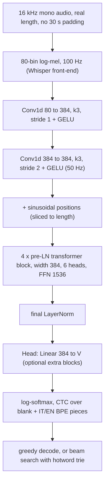

# 02 — Model architecture

## 1. Overview



The encoder is the pretrained Whisper-tiny encoder. The Whisper decoder, its 51,865-token embedding table and
its language/task prefix tokens are **not used**. The only new parameters are the CTC head (and, optionally,
a few extra blocks — §7).

## 2. Front-end (features)

Must match what the pretrained encoder saw, bit for bit in definition (it is also re-implemented in JS, see `06`):

| Step | Value |
|---|---|
| Sample rate | 16,000 Hz, mono, float in [−1, 1] |
| STFT | `n_fft = 400`, `hop = 160`, periodic Hann window of length 400, `center = True`, reflect padding of 200 samples each side; the **last STFT frame is dropped** (so frames = `N // 160`) |
| Power spectrum | `|STFT|²`, 201 bins |
| Mel filterbank | Whisper's own 80×201 Slaney filterbank (`mel_filters.npz` from the `openai-whisper` package, MIT). It is shipped as `mel_filters.bin` (80×201 float32 ≈ 64 KB) so no runtime re-derives it. |
| Log compression | `log10(max(mel, 1e-10))`; then `max(x, x.max() − 8.0)` (**per clip**); then `(x + 4) / 4` |

Note on padding: Whisper pads audio to 30 s *before* the STFT, and its per-clip maximum comes from real speech
(padding is silence), so a per-clip maximum on the unpadded clip is equivalent. This equivalence is checked by a
test on a padded versus unpadded clip.

## 3. Encoder (exact reproduction of Whisper-tiny)

Source weights: `openai/whisper-tiny` (MIT). The encoder is re-implemented in ~100 lines of plain PyTorch
(no `transformers` dependency at train/export time) and the weights are mapped over once by a conversion script.
The parity test requires the new module to match `transformers`' `WhisperEncoder` within 1e-4 (fp32) on a 30 s
padded input — offline on random weights (`tests/test_convert.py`, CI). **Measured 2026-10-19** on the released
checkpoint: the stored `embed_positions` table differs from the pure sinusoid formula by 3.03e-4 (a precision
artifact of the original training stack), and `transformers` itself moves the encoder output by 2.2e-3 when
switching its own sdpa↔eager kernels — the fp32 noise floor of any independent re-implementation with these
weights. The conversion gate is therefore 1e-3 against the eager reference with the checkpoint positions
substituted (measured: 5.2e-4, relative 2.8e-5); the model regenerates the formula table, so the init deviation
from HF at the position input is bounded by that 3e-4 (see `stt/convert_whisper.py`).

| Part | Specification |
|---|---|
| `conv1` | `Conv1d(80, 384, kernel 3, stride 1, padding 1)` + GELU |
| `conv2` | `Conv1d(384, 384, kernel 3, stride 2, padding 1)` + GELU. Output length `T_enc = ceil(T_mel / 2)`; 50 Hz, i.e. 20 ms per frame. |
| Positions | Fixed sinusoids, 1500 × 384 (`log_timescale_increment = ln(10000)/(channels/2 − 1)`); **sliced to `T_enc`**; not learned, not stored in checkpoints. |
| Block (× 4) | `x = x + Attn(LN1(x))`; `x = x + MLP(LN2(x))`. Pre-LN. |
| Attention | 6 heads × 64; `q`, `v`, `out` projections have bias, **`k` has none**; q and k are each scaled by `64^-0.25`. Bidirectional (no causal mask). |
| MLP | `Linear(384, 1536)` → GELU → `Linear(1536, 384)` |
| Final | `LayerNorm(384)` |

Maximum length: 1500 frames = **30 s** (the sinusoid table). Longer audio is chunked (`06`).

### Variable length and batching

- **Inference:** one clip at its true length (batch = 1). No padding, no mask.
- **Training:** clips are bucketed by duration and padded to the longest in the batch; the encoder takes a
  **key-padding mask** built from per-clip lengths, so padded frames are never attended to. CTC receives the
  true `T_enc` per clip. A test requires batched and single-clip logits to agree within tolerance.
- **Why truncated input is a risk:** the pretrained encoder only ever saw 30 s windows (speech followed by
  silence). FUTO's ACFT work needed a self-distillation loss to protect Whisper's *decoder* from shorter
  encoder contexts; because we drop the decoder, plain CTC fine-tuning on unpadded clips should suffice — H1
  verifies this (padded vs truncated), H2 trains on truncated input.

## 4. Parameter arithmetic (V_sp = 1024, V_ctc = V_sp + 1 = 1025)

| Part | Parameters |
|---|---|
| `conv1` (80·384·3 + 384) | 92,544 |
| `conv2` (384·384·3 + 384) | 442,752 |
| One block: attention (4·384² + 3·384 biases) = 590,976; MLP (2·384·1536 + 1536 + 384) = 1,181,568; two LayerNorms = 1,536 | 1,774,080 |
| 4 blocks | 7,096,320 |
| final LayerNorm | 768 |
| **Whisper-tiny encoder** (without positions) | **7,632,384** |
| CTC head `Linear(384, V_ctc)` (V_ctc = 1025) | 394,625 |
| **Total shipped** | **8,027,009** |
| Sinusoidal positions (1500×384 = 576,000) | not parameters — generated in the graph |

(The throw-away benchmark in `04-training.md` used PyTorch's `nn.TransformerEncoderLayer`, whose `k` projection has
a bias: 8,028,160 parameters with a 1024-wide head — within 1,151 of the total above.)

## 5. Tokenizer and output vocabulary

| Item | Specification |
|---|---|
| Type | SentencePiece **BPE**, one **shared** Italian+English vocabulary (both Latin script, so no language switch is needed to spell "meeting" or "deployato"). |
| Size | **1024** to start (candidates 512 / 1024 / 2048, decided by an ablation after H2 only if time permits). |
| Training text | Transcripts of the training sets (Italian-weighted ≈ 70/30 IT/EN by text), the mixed sentences (`03-data.md` §6), and a curated list of ≈ 1–2k English terms common in Italian work/tech speech so BPE has good pieces for them. Test-set sentences are never included; vocabulary-level overlap (single terms) is allowed. |
| Options | `model_type=bpe`, `character_coverage=1.0`, no BOS/EOS/PAD, `unk_id=0`, input already normalized by `normalize()`; spaces become `▁`. |
| CTC ids | `blank = 0`; `ctc_id = sp_id + 1`. Output size `V_ctc = V_sp + 1`. `unk` should never occur because utterances containing characters outside the charset are dropped. |
| Charset | `a–z`, `à è é ì í ò ó ù ú`, apostrophe `'`, space. Other Latin diacritics fold to the ASCII base letter; everything else is dropped by `normalize()`. |
| Output form (v0.1) | **Lowercase, no punctuation** — training and scoring share one normalization. Casing/punctuation is a later post-processor (backlog). |
| Reported statistics | Tokens per word and per second on the training text; share of English terms that tokenize to ≤ 3 pieces. (Rough expectation, unmeasured: 4–6 tokens per second of speech, far below the 50 frames/s of the encoder, so CTC length constraints are not a concern.) |

## 6. CTC head and decoding

- **Head:** `Linear(384, V_ctc)` on the encoder output, then `log_softmax` in fp32.
- **Loss:** `CTCLoss(blank=0, zero_infinity=True)` in fp32 (PyTorch 2.14 runs CTC forward and backward natively on MPS).
- **Greedy decoding (default):** argmax per frame → collapse repeats → drop blanks → join pieces, `▁` → space.
- **Hotword beam search (optional, decode-time only, no retraining):** CTC prefix beam search over the
  log-probabilities with a **trie of hotword token sequences**; each token that extends a trie path adds a score
  bonus; when the path breaks, the bonus accumulated for the partial match is removed (backoff). Hotwords are
  tokenized with the canonical segmentation plus a few alternative segmentations (SentencePiece sampling).
  Defaults to tune on dev: beam 8, bonus 1.0–3.0 per token. The Python implementation is the reference; JS is a port
  validated against it on fixtures.
- **Silence/noise:** blank dominates, so the transcript is empty by construction. CTC models can still emit junk
  on non-speech such as music — the evaluation reports this separately (`05`).

### What a CTC head gives up (and mitigations)

| Limitation | Effect | Mitigation |
|---|---|---|
| Frame-wise conditional independence; no language model | More spelling and word-boundary errors, especially for rare English words | Hotwords at decode time; BPE size ablation; mixed training data; optional extra blocks; follow-up: detachable n-gram LM head (as in Metro-ASR) |
| No punctuation/casing | Raw lowercase output | Out of scope for v0.1; tiny post-processor later (FUTO PCEC-style) |
| Acronyms ("KPI") are spoken as letter names ("cappa-pi-i" vs "kay-pee-eye") | Likely the hardest category | Hotwords; reported separately; excluded from the headline bar if H3 shows no gain |

## 7. Size, compute and variants

**Runtime size** (int8 via ONNX dynamic quantization; exact numbers are measured at export):

| Part | fp32 | int8 |
|---|---|---|
| Transformer blocks + head (7.49 M weights) | 30.0 MB | ≈ 7.5 MB |
| Convolutions (0.54 M weights) | 2.1 MB | 0.5 MB if quantized, 2.1 MB if left fp32 (ORT dynamic quantization of `Conv` is limited) |
| LayerNorms, biases, scales | ≈ 0.1 MB | ≈ 0.1 MB |
| `mel_filters.bin`, `vocab.json`, `config.json` | ≈ 0.07 MB | ≈ 0.07 MB |
| **Total** | ≈ 32 MB | **≈ 8–10 MB** (fp16 weights would be ≈ 16–17 MB) |

**Compute:** ≈ 0.8 GFLOP per second of audio forward (≈ 0.71 GFLOP from the 4 blocks at 50 frames/s, ≈ 0.06 GFLOP from
the convolutions, plus attention that is negligible for clips of seconds). Measured, not assumed, in the browser.

**Variants** (use only when a gate fails):

| Variant | Encoder | Head | Params | int8 size (arithmetic) | When |
|---|---|---|---|---|---|
| **v0.1 default** | Whisper-tiny | linear | 8.03 M | ≈ 8–10 MB | default |
| Extra capacity | Whisper-tiny | + 2 transformer blocks (width 384) | 11.6 M | ≈ 11–13 MB | H2 misses the bar but is close |
| Pooled to 25 Hz | Whisper-tiny | linear after a stride-2 pooling of the encoder output (25 Hz) | 8.03 M | same | only if browser speed misses the bar |
| **Whisper-base fallback** | Whisper-base (width 512, 6 blocks, 8 heads, FFN 2048) | linear | 20.35 M (encoder 19.82 M + head 0.53 M) | ≈ **20.5–23.5 MB — at or slightly above the 20 MB ceiling** | H2 gate fails (`04`); requires relaxing the ceiling to ≈ 25 MB |

The Whisper-base figure is a correction to an earlier rough statement of "about 20 MB": by the arithmetic above it
is a little over the ceiling, so choosing it is an explicit decision to relax the size constraint.

## 8. Interfaces (contracts for the implementation)

```text
features.log_mel(wav: float32[N]) -> float32[80, N // 160]          # reference implementation
model.forward(mel: float32[B, 80, T], mel_lengths: int[B])
    -> log_probs: float32[B, ceil(T/2), V_ctc], out_lengths: int[B]
decode.greedy(log_probs, length) -> str
decode.beam(log_probs, length, hotwords: list[str], beam: int, bonus: float) -> str
tokenizer.encode(text) -> list[int] ;  tokenizer.pieces[ctc_id] -> str
```

Exported ONNX graph: input `mel` `[1, 80, T]` with dynamic `T`; output `log_probs` `[1, ceil(T/2), V_ctc]`.
