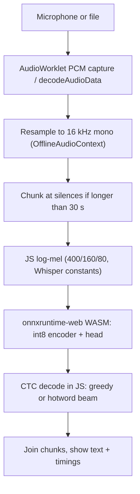

# 06 — Export and browser runtime

## 1. Scope of v0.1

- **Record-then-transcribe**: capture audio, then transcribe it. Clips ≤ 30 s run in one pass; longer audio is split.
- **No streaming, no VAD, no WebGPU, no punctuation.** (Backlog: pseudo-streaming by re-decoding a growing buffer,
  Silero VAD ≈ 2 MB, WebGPU.)
- The same ONNX graph runs on native `onnxruntime` for edge devices; a sherpa-onnx integration is a follow-up.

## 2. Pipeline in the browser



| Stage | Specification |
|---|---|
| Capture | `getUserMedia` (mono) → `AudioWorklet` collects float PCM at the context's native rate; or a dropped file via `decodeAudioData`. |
| Resample | `OfflineAudioContext(1, n·16000/sr, 16000)` to 16 kHz mono. Any difference from the training resampler is covered by an end-to-end test on recorded clips. |
| Chunking | If longer than 30 s: frame energy in 25 ms windows with an adaptive threshold; cut at the quietest point within the last 5 s before 30 s; minimum chunk 1 s; transcripts joined with a space. |
| Features | Direct, exact implementation of `02` §2: reflect-pad 200, Hann (periodic) window, **true 400-point real DFT** via precomputed 201×400 cos/sin matrices (≈ 16 M MACs per audio-second — negligible; a zero-padded 512-point FFT would shift the frequency grid and is **not** allowed), power, multiply by the shipped `mel_filters.bin`, log10, per-clip max−8 clamp, `(x+4)/4`; drop the last frame. |
| Inference | `onnxruntime-web`, `executionProviders: ['wasm']`, SIMD on, `numThreads = min(4, hardwareConcurrency)` when cross-origin isolated, else 1; graph optimization `all`; dynamic input length. |
| Decode | Greedy in ~20 lines; hotword beam search in ~100 lines of JS, a port of the Python reference. `▁` → space; no SentencePiece runtime needed. |
| Output | Lowercase text without punctuation (v0.1), per-chunk text, timings (feature, inference, decode), RTFx. |

**Cross-origin isolation:** WASM threads need `SharedArrayBuffer` → `Cross-Origin-Opener-Policy: same-origin` and
`Cross-Origin-Embedder-Policy: require-corp` (Safari requires `require-corp`). The demo ships a tiny static server that sets
them and falls back to single-thread mode without them.

## 3. Artifact

```text
release/
  model.int8.onnx      ≈ 8–10 MB   encoder + head + log-softmax
  vocab.json           pieces by CTC id, blank = 0, "▁" space marker
  mel_filters.bin      80×201 float32, 64 KB (Whisper's filterbank, MIT)
  config.json          constants and hashes (below)
  NOTICE               Whisper MIT notice + dataset credits
  README.md            model card
```

```json
{
  "name": "moth-stt", "version": "0.1.0", "sample_rate": 16000,
  "features": {"n_fft": 400, "hop": 160, "n_mels": 80, "window": "hann_periodic", "center": true,
               "pad_mode": "reflect", "drop_last_frame": true, "floor_range": 8.0, "scale": "(x+4)/4",
               "mel_filters": "mel_filters.bin"},
  "model": {"file": "model.int8.onnx", "input": "mel", "output": "log_probs", "frame_rate_hz": 50, "max_seconds": 30},
  "tokenizer": {"vocab": "vocab.json", "blank_id": 0, "space_marker": "▁"},
  "decode": {"default": "greedy", "beam": 8, "hotword_bonus": 2.0},
  "files": {"model.int8.onnx": "sha256:…", "vocab.json": "sha256:…", "mel_filters.bin": "sha256:…"}
}
```

The loader verifies every hash before use. Distribution: a Hugging Face model repository under Apache-2.0; the demo caches
files with the browser Cache API after the first download (the model downloads once).

## 4. Export

1. **Export fp32:** `torch.onnx.export` of the inference module (batch 1, dynamic time axis; opset ≥ 17), including the
   final `log_softmax`. Sinusoidal positions are **generated in-graph** from the dynamic length (`Range`/`Sin`/`Cos`) so that a
   1500×384 constant (2.3 MB fp32) does not enter the file; if in-graph generation is awkward, store the table as fp16 (≈ 1.1 MB).
2. **Validate:** PyTorch fp32 vs ONNX fp32 logits, max-abs diff ≤ 1e-3, on fixed clips of 1, 5, 10, 29 s.
3. **Quantize:** `onnxruntime.quantization.quantize_dynamic` (weights int8, per-channel for MatMul). Convolutions may remain
   fp32 if dynamic quantization does not support them in the graph (≈ +1.6 MB). If int8 is outside the noise interval of fp32:
   (a) static quantization with ≈ 200 dev clips for calibration, (b) keep the LayerNorm-adjacent ops in fp32,
   (c) fp16 weights (≈ 16–17 MB; still under the ceiling).
4. **Package:** write `config.json`, hashes and `NOTICE`.

## 5. Tests

| Test | What it proves |
|---|---|
| `normalize` property + fixture tests | one text rule |
| **Mel parity**: Python reference vs JS on fixture clips (1 s, 5 s, 29 s, silence, clipping) | no train/serve skew; tolerance 1e-3 max-abs after normalization |
| **Padding equivalence**: per-clip max clamp on padded vs unpadded clip | the front-end claim in `02` §2 |
| **Encoder parity**: own module vs `transformers.WhisperEncoder`, 30 s padded, fp32 | faithful reproduction (≤ 1e-4) |
| **Batch parity**: batched+masked vs single-clip logits | masks are correct |
| **Export parity**: PyTorch fp32 vs ONNX fp32 vs ONNX int8 logits and greedy transcripts | export does not change the model |
| **Decoder parity**: Python vs JS greedy and beam on fixture log-probs | the port is faithful |
| **Browser e2e**: headless Chromium (Playwright) with a fake audio device (`--use-fake-device-for-media-stream --use-file-for-fake-audio-capture=clip.wav`) or a file input, ≈ 20 clips | transcript in the browser equals Python's; resampler difference is acceptable |
| **Speed benchmark** | browser RTFx feeds the ≥ 10× bar; also logs load time and memory |

## 6. Error handling and user-facing behavior

| Situation | Behavior |
|---|---|
| Microphone permission denied / no device | Clear message; file upload still works |
| No WASM SIMD / unsupported browser | Message naming the requirement; no crash |
| Not cross-origin isolated | Single-thread mode, with a visible note |
| Model download fails or hash mismatch | Error with retry; cache entry discarded |
| Silence / noise | Empty transcript (no placeholder text) |
| Audio > 30 s | Chunked automatically |
| Hotword list empty or malformed | Ignored (greedy) with a note |

## 7. Expected performance (to be measured, not assumed)

Forward cost ≈ 0.8 GFLOP per audio second. If WASM int8 sustains ≈ 10 GFLOP/s effective single-threaded, that is ≈ 12×
real time; threads and SIMD should improve on that. The ≥ 10× bar is therefore plausible but **unproven** — H4 measures it
with a random-weight export early so that a miss can still change the architecture (stride-2 pooling to 25 Hz halves the cost).
